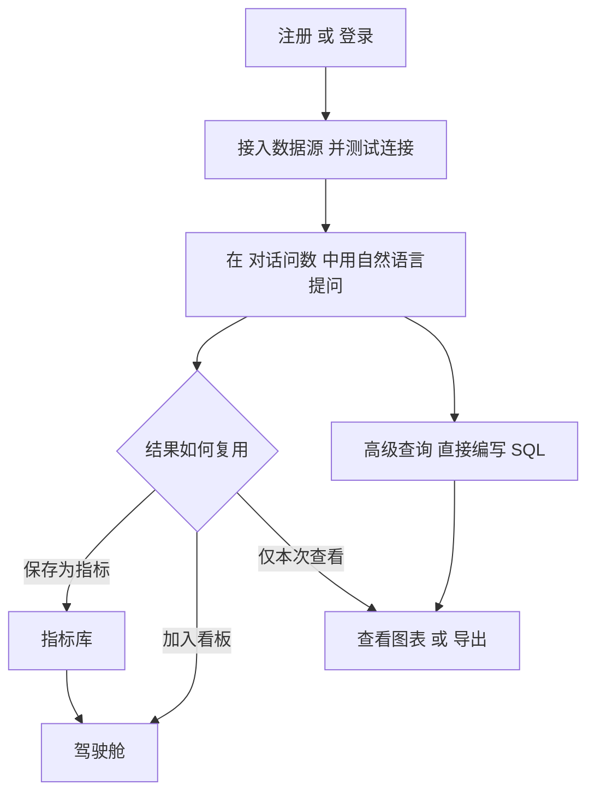
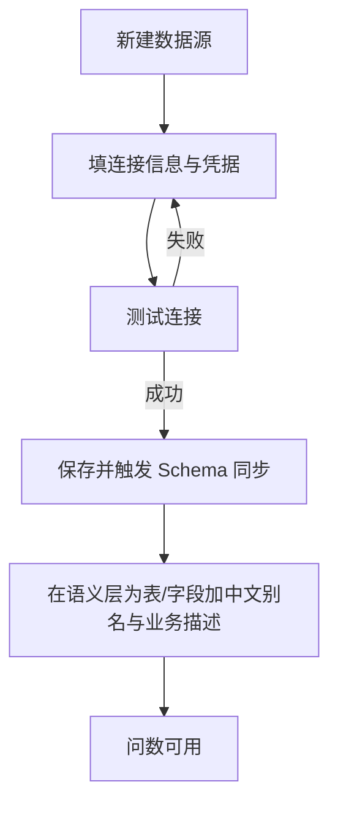

# aibi 用户操作手册

> 面向普通用户与组织管理员，介绍从接入数据到对话问数、沉淀指标、搭建驾驶舱、协作共享的完整操作路径。文中流程图使用 Mermaid 绘制，若渲染器不支持则以代码文本形式显示，不影响阅读。

---

## 一、产品简介

aibi 是一个**对话式问数平台**：连接业务数据库或文件，用自然语言提问，平台自动生成 SQL、查询数据并给出图表。无需编写 SQL 即可完成取数、分析、看板搭建与团队共享。

核心能力：

- **对话问数**：用中文/英文描述问题，AI 生成并执行 SQL，返回表格与智能图表。
- **高级查询**：面向熟悉 SQL 的用户，提供可视化构造器、SQL 编辑器（智能补全、格式化、语法高亮）、运行选中片段、图表与导出。
- **指标库**：把一次好的问数结果保存为可复用指标，沉淀企业口径。
- **驾驶舱**：用指标组件拖拽搭建可视化看板，支持大屏投屏与公开分享。
- **数据源**：接入关系型数据库、OLAP 数仓、CSV/Excel/Parquet 文件及 S3/OSS/MinIO 对象存储。
- **组织协同**：邀请成员、按角色授权、配置数据可见性与脱敏、智能预警与站内信。
- **嵌入与开放**：对话可嵌入第三方页面；对外提供标准 MCP 接口供 AI 客户端调用。

### 1.1 整体使用流程

### 1.2 术语表

| 术语 | 说明 |
| --- | --- |
| 数据源 | 一个可查询的数据连接，如 MySQL 库、一张 Excel 表、一个 S3 文件 |
| 问数 | 用自然语言发起一次查询请求的过程 |
| 指标 | 保存下来的问数结果（含 SQL 口径），可复用、可加入驾驶舱 |
| 驾驶舱 | 由多个图表组件组成的可视化看板 |
| 租户 / 组织 | 同一企业下的工作空间，成员共享数据源与配额 |
| 配额 | 套餐对问数次数、数据源数量、席位的限制 |
| PAT | 个人访问令牌（`aibi_pat_*`），MCP 客户端凭它调用 `/mcp` |

---

## 二、账号与工作区

### 2.1 注册与登录

1. 打开平台，点击右上角「注册」创建账号；已有账号直接「登录」。
2. 登录后默认进入「对话问数」页面（应用路径 `/app`）。
3. 顶部右上角头像可进入「个人中心」，查看账号信息、所属组织与套餐。

> 应用根路径 `/` 为产品官网（套餐与介绍），实际工作台在 `/app` 下。

### 2.2 套餐与配额

平台提供三档套餐，配额在「平台后台 · 席位与配额」由运营配置：

| 套餐 | 问数每日配额 | 数据源数量 | 席位 | 组织治理 | MCP 速率档 |
| --- | --- | --- | --- | --- | --- |
| 免费版 FREE | 20 次/日 | 1 个 | 按套餐 | 不含 | 10 次/分钟 |
| 专业版 PRO | 1000 次/日 | 5 个 | 按套餐 | 含 | 60 次/分钟 |
| 企业版 ENTERPRISE | 不限 | 不限 | 不限 | 含 | 300 次/分钟 |

> 免费版隐藏组织治理类菜单（成员、邀请、角色权限等），避免"可见不可用"。

---

## 三、接入数据源

数据源是所有问数的前提。接入后在「对话问数 / 高级查询」中即可选择使用。

### 3.1 接入流程

### 3.2 支持的数据源类型

- **内置**：MySQL、PostgreSQL、SQLite；CSV、Excel、Parquet 本地上传
- **冷驱动插件化按需加载**：SQL Server、Oracle、ClickHouse、Hive、Trino、Presto
- **对象存储**：S3、OSS、MinIO（配合文件类数据源）

### 3.3 凭据安全

数据源账号/密码以 **AES-GCM** 加密存库，主密钥 `AIBI_CIPHER_KEY` 由运维经环境变量注入、独立于数据库；即使元数据库泄露也无法解密业务库凭据。

### 3.4 语义层调优（大幅提升准确率）

问数准确率取决于 LLM 对表结构的理解。在「数据源 · 语义层」：

- 给每张业务表加中文名与用途描述；
- 给字段加中文别名与口径说明（如 `amount` → "销售额（含税，元）"）；
- 标注枚举字段的字典（如 `status: 1=已支付, 2=已退款`）；
- 标记敏感字段以启用脱敏与访问控制。

---

## 四、对话问数

### 4.1 使用步骤

1. 顶部菜单进「对话问数」；
2. 选择数据源（默认第一个可见）；
3. 输入自然语言问题（如"上个月的销售额是多少"）；
4. 系统按 15 个阶段流式返回：意图理解 → Schema Linking → SQL 生成 → 只读校验 → 执行 → 图表推荐 → 洞察生成 → 质量校验；
5. 结果区展示表格 + 推荐图表 + AI 结论 + 质量分。

### 4.2 复合问题拆分

一句问句包含多个子问时（如"上月销售额和订单量各是多少"），系统自动拆为多子问并发执行，逐段返回结论。若某段超时或代价拦截，`answered=false` 明确标注，不会给出"看似答了实际为空"的误导结果。

### 4.3 安全护栏

- **只读**：NL 生成的 SQL 经 JSqlParser 静态分析，非 SELECT 语句一律拒绝；
- **手术式改写**：自动补 `WHERE tenant_id = ?` 行级过滤；字段级脱敏按调用者真实角色生效；
- **代价熔断**：预估扫描行数/列数超阈直接拒答并提示"请缩小时间窗"；
- **配额与限流**：日配额 + 分钟速率双重护栏，防止 Agent 循环打爆。

---

## 五、指标库与驾驶舱

### 5.1 沉淀指标

好的问数结果可"保存为指标"——记下 SQL 口径、名称、别名、口径描述，团队所有成员都能直接引用。

### 5.2 搭建驾驶舱

1. 「驾驶舱」→ 新建；
2. 从指标库拖入卡片/趋势图/排行/仪表盘等组件；
3. 布局、配色、主题；
4. 发布为工作台或投屏大屏；
5. 可开启"公开分享"生成免登录链接（凭分享令牌访问）。

### 5.3 智能预警

为关键指标设阈值规则，命中即推送到站内信与配置的邮件/短信渠道。定时扫描由后端 `AlertEngineService` 驱动，cron 可配置。

---

## 六、组织协同与权限

### 6.1 角色矩阵

| 角色 | 数据源 | 指标 | 驾驶舱 | 成员管理 | MCP 令牌 |
|------|--------|------|--------|----------|----------|
| OWNER | 全 | 全 | 全 | 全 | 签发/吊销 |
| ADMIN | 读写 | 读写 | 读写 | 邀请/移除 | 签发/吊销 |
| EDITOR | 读 | 读写 | 读写 | — | 自签发 |
| VIEWER | 读 | 读 | 读 | — | — |
| AUDITOR | 读 | 读 | 读 | 只读列表 | 只读列表 |

具体权限点见 [角色权限体系与组织协同设计](../02-architecture/角色权限体系与组织协同设计.md)。

### 6.2 数据可见性与脱敏

- **行级**：按组织/部门/自定义表达式过滤；
- **列级**：敏感字段按角色脱敏（如手机号中间四位掩码）或完全不展示；
- **审计**：所有查询与工具调用留痕（用户、时间、SQL、结果行数）。

---

## 七、嵌入与开放

### 7.1 iframe 嵌入对话

在「分享 · 嵌入」生成嵌入令牌与 `iframe` 片段，配置允许的 `allowedOrigins`，即可把对话问数嵌入到第三方系统。嵌入侧只暴露"对该数据源提问"及其会话回看，不含任何管理面能力。

### 7.2 对外 MCP（供 AI 客户端调用）

MCP（Model Context Protocol）让外部 AI 客户端（Claude Desktop / 豆包 / Cursor / Dify / 自建 Agent 等）以标准协议调用 aibi 的问数能力。

**四步接入：**

1. 平台后台「MCP 令牌」为目标组织的目标用户签发一枚 PAT（`aibi_pat_*`），仅此一次显示明文；
2. 客户端填 MCP 端点 `https://<你的域名>/mcp` 与令牌（Bearer）；
3. 客户端调用 `tools/list` 发现工具（`ask_data` / `list_datasources` / `list_metrics` / `refresh_metric`）；
4. 用 `tools/call ask_data` 用自然语言问业务库，返回表格、结论、质量分。

**安全边界：**

- 绝不提供 `run_sql` 等裸 SQL 工具；
- 每次调用按 PAT 所属用户的**真实角色**执行——权限、脱敏、配额、限流、审计全部照常生效；
- 令牌可即时吊销（库里只存哈希，明文不落盘）；
- 支持外部 IdP 签发的 OAuth 2.1 JWT（配 `AIBI_MCP_JWKS_URL` 后启用 RS256 验签与 iss/aud 校验）。

详见 [对外 MCP 能力方案](../04-analysis/对外MCP能力方案.md)。

---

## 八、常见问题（FAQ）

**Q：问数结果不准怎么办？**
A：先在语义层给相关表和字段加中文名与描述；把常用的好结果保存为指标，后续优先命中指标口径；问题尽量带时间范围与分组维度。

**Q：数据源凭据会外泄吗？**
A：不会。凭据以 AES-GCM 加密存储，主密钥独立注入，且只经环境变量下发；库内看不到明文，接口返回也只给前缀掩码。

**Q：MCP 令牌丢了怎么办？**
A：平台后台「MCP 令牌」立即吊销旧令牌、签发新令牌；由于库里只存哈希，旧令牌一经吊销立即失效，无需重启。

**Q：能否禁止普通用户自己签发 PAT？**
A：`admin:mcp:write` 权限点控制签发能力，默认只给 SUPER_ADMIN 与 OPERATOR；组织内如需放开，按角色授权即可。

**Q：为什么外部 MCP 客户端连不上？**
A：三步自检——(1) `curl http://<域名>/.well-known/aibi-mcp` 看是否 200；(2) 检查 `AIBI_MCP_RESOURCE_URL` 是否与客户端填入的 URL 完全一致（audience 校验按 RFC 8707 严格匹配）；(3) 客户端是否传了 `Authorization` 头（本服务允许省略 `Bearer ` 前缀，兼容部分客户端只填裸令牌）。

---

## 九、进一步阅读

- [docs 索引](../README.md)
- [前后端架构设计](../02-architecture/前后端架构设计.md)
- [SaaS 多租户与数据源接入设计](../02-architecture/SaaS多租户与数据源接入设计.md)
- [角色权限体系与组织协同设计](../02-architecture/角色权限体系与组织协同设计.md)
- [对外 MCP 能力方案](../04-analysis/对外MCP能力方案.md)
- [本地启动与联调](./本地启动与联调.md)
