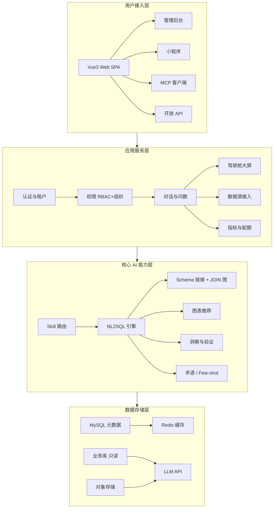
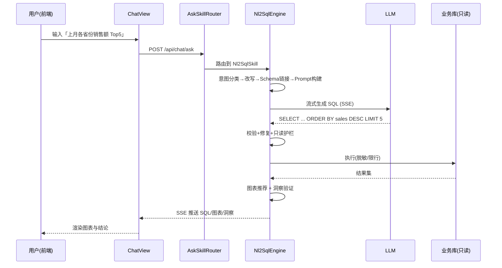
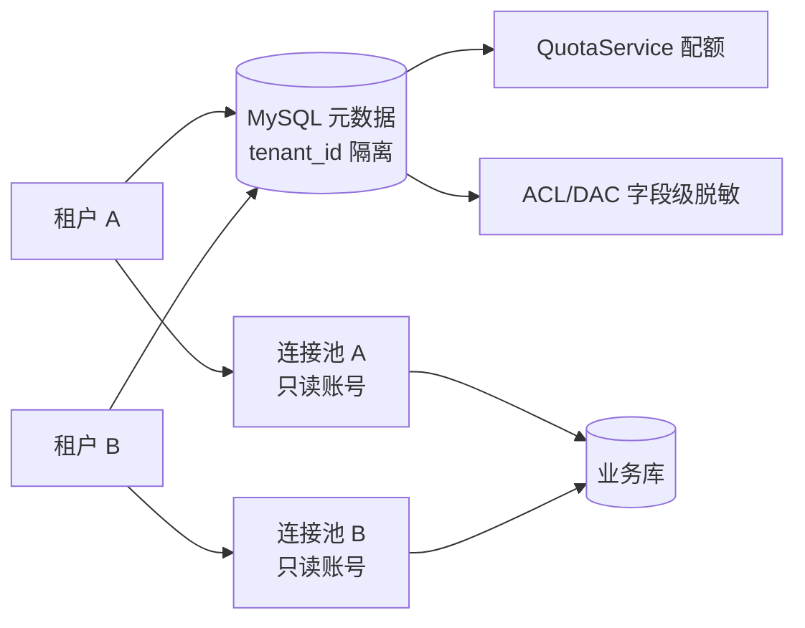

# AIBI · AI 练手项目学习指南

> 本文把 **AIBI**（一个 BI + AI 数据平台）当作「AI 练手项目」来拆解：它同时覆盖了**自然语言转 SQL（NL2SQL）、大模型路由、RAG 式 Few-shot、图表智能推荐、对话式洞察、多租户数据隔离、MCP 开放集成**等一组最热门的 AI 工程课题。本文目标不是重复产品文档，而是给你一张「从哪里入手、改哪里、能学到什么」的地图。

---

## 0. 这个项目是什么

AIBI 是一个**多租户 AI 数据分析平台**：用户用自然语言提问，系统自动生成 SQL、查业务库、出图表与洞察，并把结果沉淀为指标、驾驶舱大屏，还能通过标准 MCP 协议对外暴露为 AI 工具。

它适合练手的理由：

- **链路完整**：从一句中文到一张可信图表，中间有 11 步可观测流水线，每一步都是独立可改的模块。
- **AI 工程味浓**：意图分类、问题改写、Schema 链接、Prompt 构建、LLM 路由、SQL 校验修复、安全护栏、图表推荐、结果洞察——都是真实生产里会遇到的坑。
- **不依赖重训练**：所有「智能」都靠 **提示词工程 + 规则 + 检索（Few-shot/术语词典）**，不需要 GPU、不需要自己训模型，本地就能跑。
- **工程规范扎实**：多租户隔离、字段级脱敏、只读护栏、限流审计一应俱全，是学「AI 系统如何安全落地」的好样本。

---

## 1. 整体架构（四层）



- **用户接入层**：浏览器 SPA（Vue3）、管理后台、小程序、MCP 客户端、开放 API 共用同一套后端。
- **应用服务层**：租户/认证/权限是横切基础；对话问数是 AI 能力的入口；驾驶舱、数据源、指标是资产沉淀。
- **核心 AI 能力层**：全部挂在「问数」主线上，是本文重点。
- **数据存储层**：元数据与业务数据分离，**业务库以只读账号接入**（安全底线）。

---

## 2. 技术栈

| 层 | 技术 |
|----|------|
| 前端 | Vue 3 + TypeScript + Vite + Element Plus + Apache ECharts + Pinia/Axios |
| 后端 | Java 17 + Spring Boot 3.2 + Spring Security/JWT + MyBatis-Plus + HikariCP + JSqlParser |
| 数据/中间件 | MySQL 8.0（元数据）、Redis 7（缓存/MQ）、Docker Compose、Nginx 反向代理 |
| AI 集成 | DeepSeek / 通义千问（OpenAI 兼容协议）、SSE 流式、标准 MCP（Streamable HTTP）、只读 SQL 护栏 |

---

## 3. 目录结构导览

### 3.1 后端模块（`backend/src/main/java/com/aibi/module/`）

按能力分组（不是按字母）：

| 分组 | 模块 | 职责 |
|------|------|------|
| AI 主线 | `chat` | 问数编排：skill 路由、NL2SQL、图表推荐、洞察验证、LLM 抽象、术语词典 |
| AI 主线 | `semantic` | 语义层 / Schema 元数据（字段业务含义、敏感标注） |
| AI 主线 | `fewshot` | 少样本样例库（检索增强） |
| AI 主线 | `chart` | 图表规则与样式 |
| AI 主线 | `attribution` / `lineage` | 归因分析、数据血缘 |
| 资产 | `dashboard` | 驾驶舱 / 大屏 / 模板 |
| 资产 | `metric` / `favorite` / `share` | 指标、收藏、分享 |
| 接入 | `datasource` | 数据源接入、连接池、方言、凭据加密 |
| 接入 | `query` | 高级查询 / SQL 编辑器 |
| 平台 | `auth` / `rbac` / `org` / `acl` / `dac` | 认证、角色、组织、权限、数据 ACL |
| 平台 | `tenant`(common) / `config` / `theme` | 多租户、配置、主题 |
| 平台 | `quota` / `audit` / `alert` / `message` | 配额、审计、告警、消息 |
| 开放 | `mcp` | 标准 MCP 服务端（Streamable HTTP + OAuth/DCR + 限流 + 进度） |
| 内容 | `manual` / `drift` | 用户手册、Schema 漂移 |

关键 AI 类（`module/chat`）：

```
chat/
├── controller/   ChatController, ChatStreamController, AskSkillController
├── skill/        AskSkillRouter(路由) → impl: Nl2SqlSkill / SchemaQaSkill / MetricSkill / DirectSqlSkill / FewShotSkill
├── nl2sql/       Nl2SqlEngine(总指挥)
│                  IntentClassifier · QuestionRewriter · SchemaLinker
│                  JoinGraph · TableRelation · PromptBuilder
│                  SqlValidator · SqlRepairer · JoinGuard · QuestionGuard
├── llm/          LlmRouter → LlmClient(DeepSeek/Qwen/兼容) · LlmConfigService
├── chart/        ChartRecommender · ChartSpec · ChartStyle
├── insight/      InsightService · VerifyService · AiChartAdvisor
├── term/         TermDictionary(术语词典)
└── guard/        ConcurrencyGuard(并发护栏)
```

### 3.2 前端视图（`frontend/src/views/`）

| 区域 | 视图 |
|------|------|
| 入口 | `LandingView`（官网）、`auth/Login`、`chat/ChatView` |
| 数据 | `datasource/`、`query/SqlEditorView`、`metric/`、`drift/` |
| 资产 | `dashboard/`（列表/编辑器）、`screen/`（大屏）、`favorite/`、`history/`、`share/` |
| 治理 | `tuning/`（语义/血缘/归因/Few-shot/表关联）、`org/`（组织/角色/ACL） |
| 平台 | `admin/`（租户/用户/配额/LLM/Manual/MCP） |

图表统一走 `components/chart/BaseChart.vue` + `useChartOption.ts`（`buildChartOption` 集中构建）+ `chartStyle.ts`。

---

## 4. 核心 AI 能力拆解（练手重点）

### 4.1 NL2SQL 流水线（11 步）

这是项目的灵魂，详见对话中的「NL2SQL 端到端链路」图：

1. **接入路由**：`ChatController` → `AskSkillRouter` 按问题类型选 `Nl2SqlSkill`
2. **意图分类**：`IntentClassifier` 规则优先，分出 趋势/对比/排名/明细/聚合
3. **问题改写**：`QuestionRewriter` 做指代消解、缺省补全（「上个月」→具体日期）
4. **Schema 链接**：`SchemaLinker` + `JoinGraph`/`TableRelation` 选表并推断关联
5. **语义增强**：`TermDictionary` + `FewShotStore` 注入同义词与历史样例
6. **Prompt 构建**：`PromptBuilder` 拼装 schema / 业务规则 / 样例
7. **LLM 推理**：`LlmRouter` → DeepSeek / Qwen，SSE 流式返回 SQL
8. **SQL 校验+修复**：`SqlValidator` + `SqlRepairer` 做白名单与语法修复
9. **安全护栏**：`JoinGuard` + `QuestionGuard` 强制只读、防注入、限行数
10. **执行统计**：`DataSourceAdapter` + `ExecStats` 脱敏 / 限量 / 计时
11. **可视化洞察**：`ChartRecommender` → `ChartSpec` → ECharts；`VerifyService` 做结果校验与洞察

> **练手价值**：每一步都是独立可改的「旋钮」。想提升准确率，先从 4（Schema 链接）和 5（Few-shot）入手，收益最大。

### 4.2 Skill 路由

`AskSkillRouter` 把一句话分发给不同 Skill（问数 / 查 Schema / 指标 / 直 SQL / 样例）。这是典型的「意图→处理器」模式，练手者可新增自己的 Skill（见第 8 节）。

### 4.3 图表推荐与洞察验证

- `ChartRecommender`：根据数据形态（时间序列/分组/排名）推荐图表类型
- `ChartSpec`：与前端 `ChartSpec` 对齐的图表描述（前后端同构）
- `VerifyService` / `InsightService`：对查询结果做统计校验，自动生成「环比/异常/占比」等文字洞察——这是让 AI 回答「不只是出图，还说明白了」的关键

### 4.4 Few-shot 与术语词典

- **Few-shot**：把「用户问法 + 正确 SQL」存为样例，检索最相近的注入 Prompt（类 RAG）
- **术语词典** `TermDictionary`：业务同义词映射（「营收」→`revenue`），解决「用户说的词和表里列名对不上」

### 4.5 LLM 抽象层

`LlmRouter` → `LlmClient`（DeepSeek / Qwen / 任意 OpenAI 兼容）。换模型只改配置，不动业务代码——是学「模型供应商解耦」的好样本。

---

## 5. 一次问数发生了什么（时序）



---

## 6. 多租户与数据安全



三条安全底线（练手时千万别破）：

1. **业务库只读账号**：应用永远用只读用户连业务库，写操作从源头禁止。
2. **SQL 护栏**：`SqlValidator`（白名单/单条只读）+ `JoinGuard`（防误伤系统表）+ `QuestionGuard`（防注入）。
3. **字段级脱敏**：`acl`/`dac` 模块按角色对敏感列脱敏，语义层标注即生效。

---

## 7. 本地启动与联调

详见 `docs/05-operations/本地启动与联调.md`。最小要点：

```bash
# 后端（JDK 17 必须显式指定，避免命中系统 JDK8）
export JAVA_HOME=/path/to/jdk17
cd backend && mvn -o -DskipTests package
java -jar target/aibi.jar --server.port=8080

# 前端
cd frontend
CODEBUDDY_SAFE_DELETE_ENABLED=0 npm install
npm run dev   # 默认 5173，代理 /api → 8080
```

注意：本地联调需**双服务保活**（后端 jar + 前端 dev），任一停了都会「系统繁忙 / 表结构没数据」。

---

## 8. 练手任务路径（由易到难）

### 入门（半天~1天，建立手感）
- **改意图关键词**：在 `IntentClassifier` 增加一类意图（如「占比」），观察 Prompt 指引变化。
- **加一个图表类型映射**：在 `ChartRecommender` 为「排名」场景补一种图表（如条形图→词云），前端 `ChartSpec` 对齐。
- **加一条术语映射**：通过 `TermDictionary` / 管理界面把你们业务的黑话映射到列名，看问数准确率变化。

### 进阶（1~3天，动核心链路）
- **新增一个 Skill**：实现 `AskSkill` 接口（如「解释这张表」），在 `AskSkillRouter` 注册，前端 `ChatView` 接结果。
- **给 Schema 链接加规则**：在 `SchemaLinker` / `JoinGraph` 增加「按命名推断外键」的启发式，提升多表 JOIN 准确率。
- **Few-shot 检索增强**：在 `FewShotStore` 换一种相似度算法（向量 / BM25），对比样例命中质量。

### 挑战（1周+，系统级）
- **MCP 工具新增**：在 `mcp/McpServerService` 暴露一个新工具（如「按指标名查最新值」），实现 `tools/list` + `tools/call` + SSE 进度。
- **多表 JOIN 推断优化**：把 `JoinGraph` 从「命名推断」升级为「结合外键元数据 + 历史查询」的概率图。
- **归因分析链路**：打通 `attribution` + `lineage`，让问数结果能点开「这个数字为什么涨」。

---

## 9. 推荐阅读（项目内文档）

| 文档 | 看什么 |
|------|--------|
| `docs/02-architecture/前后端架构设计.md` | 权威架构与模块职责 |
| `docs/02-architecture/SaaS多租户与数据源接入设计.md` | 租户隔离、只读连接池 |
| `docs/02-architecture/角色权限体系与组织协同设计.md` | RBAC + 组织协同 |
| `docs/04-analysis/智能问数技能体系与标准对照.md` | NL2SQL 能力对标 |
| `docs/04-analysis/对外MCP能力方案.md` | MCP 设计 |
| `docs/05-operations/本地启动与联调.md` | 跑起来 |
| `docs/05-operations/用户操作手册.md` | 功能全景 |
| `docs/03-development/P0功能补全与变更记录.md` | 真实迭代脉络（看别人怎么改） |

---

## 10. 常见坑（实战沉淀）

1. **JDK 版本**：构建/运行必须 JDK 17；系统默认若是 JDK8 要显式 `export JAVA_HOME`，否则编译或运行诡异失败。
2. **context-path**：后端接口前缀是 `/api`，前端 `request.ts` 的 baseURL 已含，**api 模块路径不要再带 `/api`**，否则变 `/api/api/...` 报 500。
3. **配置无缓存**：`aibi.config.cache-ttl-seconds` 默认 0 = 每次查库。在循环里调配置读取会触发 N+1 式串行查库（曾导致 `/api/metric` 吊死 35s）——**配置读取务必提到循环外**。
4. **SQL 别名铁律**：多表查询 `FROM` 必须 `AS t1/t2…`，列限定必须用别名；单表时 `qual()` 退回表名会 `Unknown column`。
5. **方言/关键字**：SELECT 别名不能用 MySQL 保留字；保留字列名三处反引号。
6. **连接池偏小**：`hikari.maximum-pool-size` 默认 10，慢接口或大并发易耗尽，必要时调大并加超时。
7. **前端主题切换**：`ThemeToggle` 给 `el-dropdown` 再包 `el-tooltip` 会吞掉 click 导致下拉打不开——保持触发器为原生按钮。
8. **构建双校验**：前端改动后必须 `vue-tsc --noEmit` + `vite build` 均 EXIT=0 再发布。

---

> 这份指南是「练手地图」而非 API 文档。最好的学习方式是：先把项目按第 7 节跑起来，挑第 8 节入门任务改一处、看一处效果，再逐步往核心链路深入。
